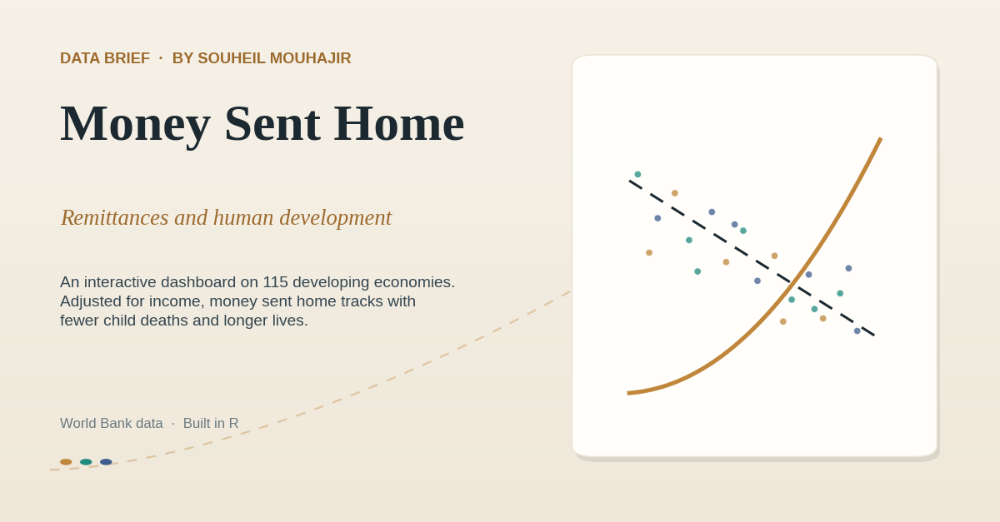

# Money Sent Home

Remittances and human development in 115 economies. A single-file interactive dashboard built from World Bank data.

Live page: https://souheil-mouhajir.github.io/money-sent-home/



## Findings

- Migrants sent **$596B** to low and middle income countries in 2023 (about **$685B** in 2024 per World Bank estimates), more than official development assistance.
- The raw correlation between remittance dependence and **under-5 mortality** across the 115 economies is near zero (r = -0.13).
- Remittances flow to poorer countries, and poverty drives child mortality on its own, so **income masks the link**. With **GDP per capita** controlled, the partial correlation is r = -0.41: about 0.8 fewer child deaths per 1,000 for each percentage point of remittances in GDP.
- Life expectancy runs about **+0.7 years** higher per step of remittance dependence, income held constant.
- A logistic model puts the odds of missing the **UN child-survival target** (under-5 mortality at or below 25 per 1,000) **43% lower** for remittance-dependent economies, adjusted for income (odds ratio 0.566).
- These are associations, not causal estimates; limitations are stated in the dashboard footer.

## What the dashboard shows

- The scale of remittances against FDI and aid, 1990 to 2023, with series isolation from the legend.
- The ten most remittance-dependent economies (Tajikistan 50% of GDP, Tonga 39%, Lebanon 31%).
- The raw versus income-adjusted scatter, the analytical core, with a toggle that redraws the relationship.
- A logistic slider for the probability of missing the UN target.
- A country spotlight with flags for all 115 economies, model-predicted risk, and a cost-of-sending calculator against the UN's 3% fee target (for Morocco, roughly $335M a year returned to families).

## Method

The analysis is a cross-section of 115 developing economies, year 2022. OLS with GDP per capita as the control; the income-adjusted panel plots the residuals of both variables on income (partial regression). The target model is a logistic regression of missing the UN threshold on remittance dependence and log GDP per capita. The analysis was first written in R for the course report; the processed dataset embedded here was rebuilt in Python (pandas, scikit-learn) and reproduces the R results, and the page renders in vanilla JavaScript and SVG with no external libraries and no network calls.

## Data

| File | Indicator |
|---|---|
| data/remittances_pct_gdp.csv | Personal remittances received, share of GDP |
| data/remittances_usd.csv | Personal remittances received, current US dollars |
| data/under5_mortality.csv | Under-5 mortality rate per 1,000 live births |
| data/life_expectancy.csv | Life expectancy at birth |
| data/gdp_per_capita_ppp.csv | GDP per capita, PPP |
| data/fdi_usd.csv | Foreign direct investment, net inflows |
| data/oda_usd.csv | Net official development assistance received |
| data/country_metadata.csv | Country names, regions, income groups, ISO codes |

All series are **World Bank World Development Indicators**, taken through the open-numbers/Gapminder mirrors. The dashboard embeds the processed 2022 cross-section directly in index.html, so the page runs with no server and no requests. The data remains under the World Bank's open data terms (CC BY 4.0).

## Repository layout

```
money-sent-home/
  index.html
  assets/
    social-card.png
    card-square.png
  data/
    eight source CSV series
  README.md
  LICENSE
```

## Local use

index.html is fully self-contained, with the processed data and 115 flag images embedded as base64; a local copy opens directly in any browser.

## Deployment

GitHub Pages serves the dashboard once the repository is named money-sent-home and Pages is enabled on the main branch (Settings, then Pages, then Deploy from a branch, main, root). The page then resolves at souheil-mouhajir.github.io/money-sent-home/ and the social preview tags in index.html resolve against that address. An alternative placement is a money-sent-home folder inside the souheil-mouhajir.github.io repository, which yields the same address without a separate Pages setting.

## Credits

This began as the team final for **Data Science for Social Good** at the George Washington University, with Sarah Gonzalez and Brian Lee. **Souheil Mouhajir** led the data analysis, statistical modeling, and visualization; this dashboard is his re-implementation of the analysis. The course report itself is not republished here.

## License

Code is under the **MIT License**. The underlying indicators remain World Bank open data (CC BY 4.0).
